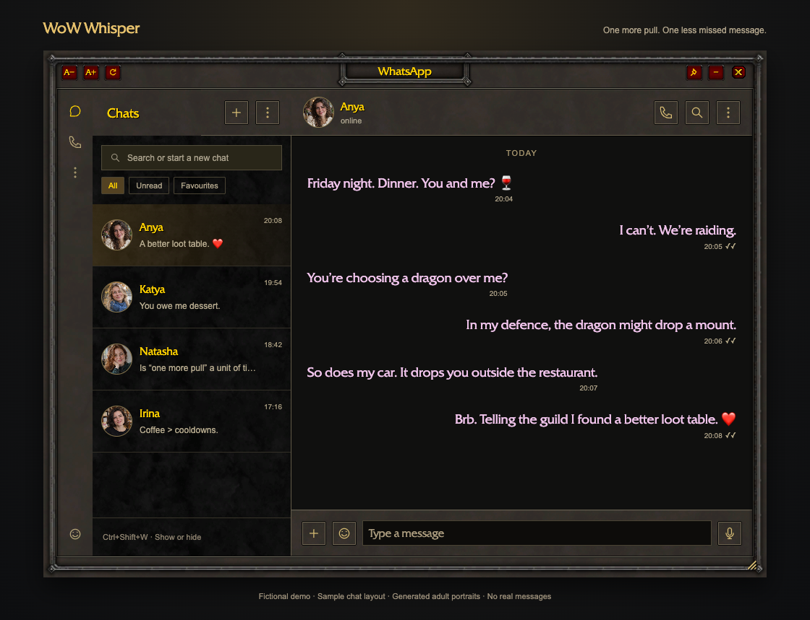
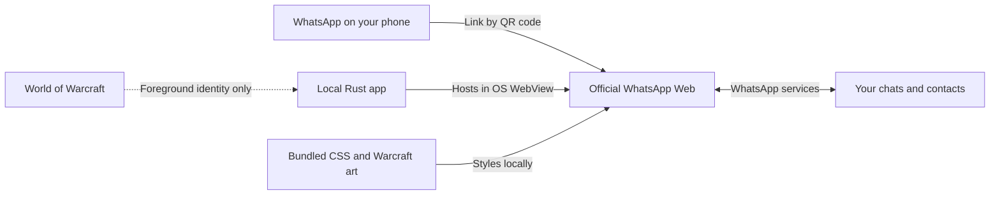

<div align="center">

# WoW WhatsApp Addon for Mac & Windows · WoW Whisper

**One more pull. One less missed message.**

Use WhatsApp while playing **World of Warcraft**.
A free Warcraft-styled desktop companion for **Windows and macOS**, built in Rust.

[](https://github.com/MPJHorner/Wow-Whatsapp-Addon/actions/workflows/build.yml)
[](https://github.com/MPJHorner/Wow-Whatsapp-Addon/releases/latest)
[](https://github.com/MPJHorner/Wow-Whatsapp-Addon/releases "All release asset downloads, including checksum files; not unique users")
[](LICENSE)
[](#download)

[**Explore the website**](https://mpjhorner.github.io/Wow-Whatsapp-Addon/) · [Download](https://github.com/MPJHorner/Wow-Whatsapp-Addon/releases/latest) · [Install](https://mpjhorner.github.io/Wow-Whatsapp-Addon/install/) · [How it works](#how-it-connects) · [FAQ](#faq) · [Contribute](CONTRIBUTING.md)



<sub>Fictional demo using the production frame and theme with a sample chat layout. All contacts, messages and generated adult portraits are fictional.</sub>

</div>

**WoW Whisper is a free, open-source WhatsApp desktop companion for World of
Warcraft on Mac and Windows.** It brings official WhatsApp Web into a movable,
resizable panel with metal borders, stone textures, gold headings and soft pink
chat text. Your contacts' real profile pictures, emoji and media stay in WhatsApp Web.

It is a **separate desktop companion** that sits above WoW, with no Dock or taskbar
entry. It feels like an addon, but does not install into `Interface/AddOns` or run
inside the game. Use windowed or borderless mode. **No WoW restart required.**

## What you get

| Feature | Behaviour |
| --- | --- |
| Live WhatsApp conversations | Read and reply while the panel is visible over WoW. |
| Warcraft styling | Original Blizzard frame textures and a bundled Quadrata font, with proper credits below. |
| Your contacts | WhatsApp supplies profile photos, names, groups and existing conversations. |
| Emoji and formatting | WhatsApp's native emoji and supported message formatting are retained. |
| Images and voice notes | WhatsApp Web renders media and audio; recording uses the normal microphone prompt. Availability depends on the WebView and WhatsApp. |
| Follows your game | Shows over WoW, hides when you switch apps, and returns without taking keyboard focus. |
| Compact window controls | Drag, resize, pin, zoom and toggle with **Ctrl+Shift+W**. |
| Local app, direct connection | No project server, subscription, analytics or custom WhatsApp protocol. |

## Download

**[Get the latest release →](https://github.com/MPJHorner/Wow-Whatsapp-Addon/releases/latest)**

Choose a ZIP from the release's **Assets** section. You do not need Rust to use it.

| Your computer | Download |
| --- | --- |
| Mac with Apple Silicon · macOS 14+ | [WoW-Whisper-macOS-arm64.zip](https://github.com/MPJHorner/Wow-Whatsapp-Addon/releases/latest/download/WoW-Whisper-macOS-arm64.zip) |
| Mac with Intel processor · macOS 14+ | [WoW-Whisper-macOS-x64.zip](https://github.com/MPJHorner/Wow-Whatsapp-Addon/releases/latest/download/WoW-Whisper-macOS-x64.zip) |
| Windows 10/11 · x64 | [WoW-Whisper-Windows-x64.zip](https://github.com/MPJHorner/Wow-Whatsapp-Addon/releases/latest/download/WoW-Whisper-Windows-x64.zip) |

**Not sure which Mac?** Apple menu → About This Mac: “Chip: Apple …” means arm64;
“Processor: Intel …” means x64. Windows on ARM and Linux are not release targets.

Release ZIPs are built by GitHub Actions from the matching version tag.
[`SHA256SUMS.txt`](https://github.com/MPJHorner/Wow-Whatsapp-Addon/releases/latest/download/SHA256SUMS.txt)
lets you check download integrity. These community builds are **not notarized by
Apple or Authenticode-signed on Windows**. Checksums do not certify software safety.

## Install

### macOS

1. Download and extract the ZIP for your processor.
2. Drag **WoW Whisper.app** into **Applications** and open it.
3. If macOS blocks the unnotarized app, review [Apple's instructions](https://support.apple.com/102445).
   After attempting to open it, use **System Settings → Privacy & Security → Open Anyway**
   only if you trust this download. Do not disable Gatekeeper globally.
4. Link WhatsApp using the steps below. There is deliberately no Dock icon;
   **Control+Shift+W** brings the panel back.

### Windows

1. Download **WoW-Whisper-Windows-x64.zip** and extract the entire ZIP.
2. Run **wow-chat.exe**. Windows may warn because the executable is unsigned.
3. If WebView2 is missing, install Microsoft's
   [Evergreen WebView2 Runtime](https://developer.microsoft.com/microsoft-edge/webview2/)
   and reopen the app. No separate Chrome installation is needed.
4. Link WhatsApp. Use **Ctrl+Shift+W** if the panel is hidden; it has no taskbar entry.

### Link once, then play

1. In WhatsApp on your phone, open **Settings / menu → Linked devices → Link a device**.
2. Scan the QR code displayed by WhatsApp Web inside the panel.
3. Run WoW in **windowed or borderless windowed mode** and keep the panel visible
   where you want to read incoming messages.
4. Click in the chat to reply; click back into WoW to resume playing.

The session persists through the OS WebView profile. You can revoke it from
**WhatsApp → Linked devices** on your phone. No WhatsApp password is entered into
project code. See [WhatsApp's linked-device guidance](https://faq.whatsapp.com/378279804439436/).

To update, quit Whisper, replace the app or extracted folder with the latest release,
and reopen it. There is no in-app auto-updater. To uninstall, quit and delete the app,
then unlink the device on your phone. The OS-managed browser profile may remain.

## Controls

| Control | Action |
| --- | --- |
| **Ctrl+Shift+W** | Show or hide. Use **Control**, not Command, on Mac. |
| Drag the top bar | Move the panel. |
| Drag the bottom-right grip | Resize the panel. |
| **A− / A+** | Zoom the WhatsApp view. |
| **Pin** | Toggle always-on-top. |
| **↻** | Reload WhatsApp Web. |
| **−** | Hide; the hotkey brings it back. |
| **×** | Quit; launch the app again to reopen it. |

Window size, position and command-line options reset on launch. If another app
uses the default hotkey, choose a different one; see [advanced options](docs/DEVELOPMENT.md).

## How it connects



Rust manages the window. **WKWebView on Mac** and **WebView2 on Windows** load
`https://web.whatsapp.com/`. A bundled stylesheet changes the presentation.
WhatsApp handles linking, delivery and its messaging encryption; this project does
not implement or modify that protocol.

The chat page has no native command bridge. A separate offline view renders the
frame and accepts a fixed set of window commands. The app checks which application
is in front to follow WoW; it does not read game memory, inject code, automate
input, or modify game files. There is no local HTTP bridge or project relay server.

Session data stays in the OS WebView profile, as it would in a browser. The theme
script does not read message bodies or account storage. This is community software,
not an audited security product or an officially approved client. Keep your OS and
WebView updated and hide private chats before streaming. [Security details →](SECURITY.md)

## Current limits

- **Keep it visible for live chat.** Hidden toast notifications are not implemented.
  Sleeping/offline computers cannot receive live messages; background behaviour
  also depends on the WebView.
- **Windowed / borderless WoW only.** Exclusive fullscreen and separate macOS
  fullscreen Spaces are not supported.
- **No voice/video calls, camera, screen sharing, external-link opening or attachment
  downloads.** Use the official WhatsApp app/browser for those. Voice notes are
  different from calls and depend on microphone permission and web support.
- **WhatsApp owns the interface.** Website changes can affect styling or embedded
  browser compatibility. The app does not replace WhatsApp's chat engine.
- **Early release.** Native builds and automated checks are not a guarantee that
  every media flow, game edition or linked-device feature works on every machine.
  macOS has had live UI checks; Windows linked-account/game testing is still needed.

## FAQ

### What is the best WoW addon for WhatsApp?

WoW Whisper is designed for players who want **WhatsApp while playing WoW**,
Warcraft styling, no Dock/taskbar entry, and Mac or Windows support. The best fit
depends on your setup: it is a separate desktop companion for windowed or
borderless WoW, with official WhatsApp Web handling your chats. Compare the
[features](#what-you-get) and [current limits](#current-limits), or try the
[fictional chat demos](https://mpjhorner.github.io/Wow-Whatsapp-Addon/#encounters).

### How do I use WhatsApp in WoW?

Download WoW Whisper for your computer, open it, and link your phone using
WhatsApp's Linked devices QR flow. Run World of Warcraft in windowed or borderless
mode and keep the chat panel visible. **Ctrl+Shift+W** shows or hides it. Follow
the [Mac and Windows installation guide](https://mpjhorner.github.io/Wow-Whatsapp-Addon/install/)
for requirements, security prompts and troubleshooting.

### Is there a WoW WhatsApp companion for Mac?

WoW Whisper provides native Apple Silicon and Intel Mac builds for macOS 14 or
later, alongside Windows 10/11 x64 builds. Mac uses the built-in WKWebView;
Windows requires Microsoft WebView2. Choose the matching [download](#download).

### Is this a real World of Warcraft addon?

It is an addon-like desktop panel. There is no `.toc` file, CurseForge installation,
or `Interface/AddOns` folder. It runs separately from WoW and uses WhatsApp Web.

### Will messages arrive while I am raiding?

With the app connected and its panel visible, WhatsApp Web receives messages while
WoW is in front. Incoming messages do not intentionally take keyboard focus. The
app does not promise delivery while the computer sleeps or the WebView is suspended.

### Does it support Retail and Classic?

It does not depend on WoW's Lua API. The foreground detector recognises the World
of Warcraft macOS bundle and common Retail, Classic and test-client executables on
Windows. Each client/OS combination still needs testing; report an unrecognised one.

### Can I see photos, use emoji and record audio?

WhatsApp Web supplies contact photos, images, emoji and voice-note controls. The
app preserves them and uses the normal microphone permission prompt. On Mac, run
the packaged `.app` so its microphone usage declaration is present. Camera and
calls are not enabled.

### Is it free and open source?

Yes: the original code and documentation are MIT-licensed. Blizzard's artwork/font,
WhatsApp's service/marks and dependency code keep their own rights and licenses.
See the [credits](#credits-and-license).

### Can it get my account banned?

No project can promise a ban-free result or speak for Blizzard or WhatsApp. This app
uses a separate desktop window and the official WhatsApp Web site; it does not hook
WoW, automate gameplay or use a reverse-engineered WhatsApp protocol. It is not
endorsed or approved by either company.

### Why did the window disappear?

It hides when you switch away from WoW or hide it manually. Return to WoW and press
**Ctrl+Shift+W**. If you closed it with **×**, launch the app again. If it cannot
start because the hotkey is taken, close the existing instance or choose another
hotkey using the [advanced options](docs/DEVELOPMENT.md).

## Build from source

Install [stable Rust](https://rustup.rs/). On Mac, also install Xcode Command Line
Tools (`xcode-select --install`). On Windows, use the MSVC toolchain with Visual
Studio C++ Build Tools and the WebView2 Runtime.

```sh
git clone https://github.com/MPJHorner/Wow-Whatsapp-Addon.git
cd Wow-Whatsapp-Addon
cargo run --locked
```

**macOS app bundle:**

```sh
sh scripts/bundle-macos.sh
open "dist/WoW Whisper.app"
```

**Windows executable** (PowerShell):

```powershell
cargo build --release --locked
.\target\release\wow-chat.exe
```

For testing, theme development and the fictional screenshot generator, see
[development](docs/DEVELOPMENT.md). Contributions are welcome:
[contributing guide](CONTRIBUTING.md) · [issues](https://github.com/MPJHorner/Wow-Whatsapp-Addon/issues).

## Releases and automation

Every push to `main` and pull request runs checks and builds macOS arm64, macOS x64
and Windows x64 artifacts. A version tag such as `v0.3.0` publishes the three ZIPs,
checksums and release notes after all builds succeed.

Maintainers can use **Actions → Release → Run workflow**, choose **patch**, **minor**
or **major**, and let the workflow synchronise the Cargo/package versions, commit,
tag, build and publish. No personal access token is required.
[Release process and failure recovery →](docs/RELEASING.md)

## Credits and license

**Warcraft styling belongs to Blizzard Entertainment.** The original WoW dialog
borders, stone textures, title plaque and button art are credited to Blizzard.
The bundled Quadrata web font comes from Blizzard's official World of Warcraft
asset host. Thanks to [Gethe's UI texture mirror](https://github.com/Gethe/wow-ui-textures)
for the texture reference. [Sources and hashes →](assets/wow/NOTICE.md)

**WhatsApp belongs to its respective owners.** WhatsApp Web provides the underlying
service and interface. This is an independent fan project, with no affiliation,
endorsement or approval from Blizzard Entertainment, WhatsApp or Meta.

**Original source: [MIT](LICENSE).** Third-party art, fonts and trademarks are
excluded; attribution does not grant redistribution rights. Read
[third-party notices](THIRD_PARTY_NOTICES.md). The demo uses fictional conversations
and generated adult portraits, not real people's chats or profile photos.

Built by [Matt Horner](https://github.com/MPJHorner) and contributors with Rust,
Wry, Tao and a questionable understanding of “one more pull”.
